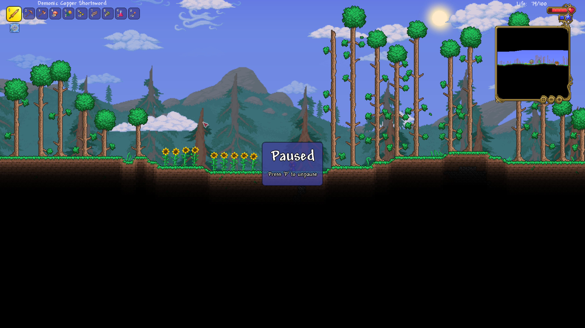

# Terraria - Pause Key

A [tModLoader](https://github.com/tModLoader/tModLoader) mod for Terraria that adds a
bindable pause key.

Press the key to pause the game; press the key again to resume. Single player only.



## Requirements

- Terraria
- tModLoader

## Installation

Download `PauseKey.tmod` from
[Releases](https://github.com/evilbananas/Terraria-PauseKey/releases) and place it in
your tModLoader `Mods` folder:

```
Documents\My Games\Terraria\tModLoader\Mods\
└── PauseKey.tmod
```

Launch tModLoader, open **Workshop → Manage Mods**, enable **PauseKey** and reload.

The key starts unbound. To set it, go to **Settings → Controls → Mod Controls** and
either click **Pause** and press a key, or use its default button to set it to `P`.

## Uninstall

- Disable the mod: open **Workshop → Manage Mods**, disable **PauseKey** and reload.
- Remove the mod: delete `PauseKey.tmod` from
  `Documents\My Games\Terraria\tModLoader\Mods\`.

## Credits

- [tModLoader](https://github.com/tModLoader/tModLoader) by the tModLoader team

## License

[MIT](LICENSE)
